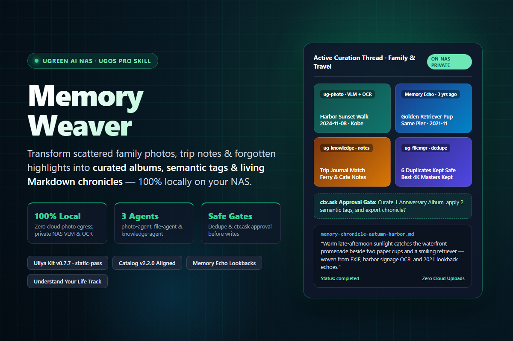
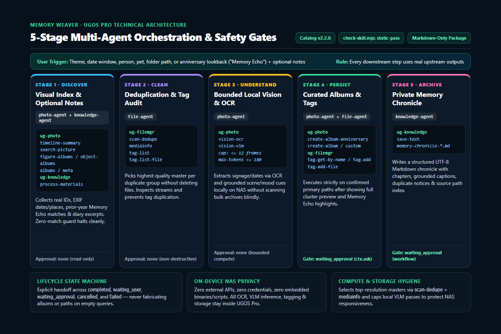
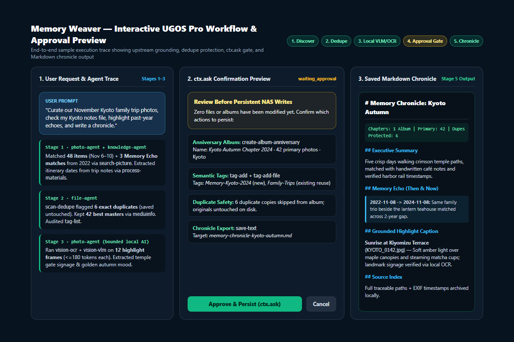

# Memory Weaver (`memory-weaver`)

> **Local-first personal memory curator & story weaver Agent Skill for UGREEN AI NAS (UGOS Pro).**
> Built for **UGREEN Hackathon 2026 on AI NAS: Bring Your Skills to UGOS** — *Understand Your Life* track.



---

## Overview

Family NAS drives hold tens of thousands of unsorted photos, duplicate copies, videos, and forgotten travel notes locked inside raw date folders. Users want shareable, emotionally meaningful life stories—yet manual sorting takes weekends, and uploading private memories to cloud AI undermines the privacy reason people own a NAS.

**Memory Weaver** transforms any natural-language request (theme, date window, person, pet, folder path, or anniversary lookback) into curated albums, non-destructive duplicate protection, semantic tags, cross-year **"Memory Echo"** highlights, and a private **Markdown Memory Chronicle**—orchestrated **100% locally** across three native UGOS Pro agents.

---

## 5-Stage Multi-Agent Orchestration (Catalog `v2.2.0`)



| Stage | Agent(s) | Exact Catalog `v2.2.0` CLI Capabilities | Responsibility |
| --- | --- | --- | --- |
| **1. Discover** | `photo-agent` + `knowledge-agent` | `ug-photo timeline-summary`, `search-picture`, `figure-albums`, `object-albums`, `albums`, `meta` · `ug-knowledge process-materials` | Locate matching photo/video clusters, cross-year Memory Echo lookbacks, EXIF/location context, and optional personal notes; exit cleanly on zero matches. |
| **2. Clean** | `file-agent` | `ug-filemgr scan-dedupe`, `mediainfo`, `tag-list`, `tag-list-file` | Exclude exact duplicate copies non-destructively (keeping top-resolution masters), inspect stream specs, and audit existing tags. |
| **3. Understand** | `photo-agent` | `ug-photo vision-ocr`, `vision-vlm` | Extract grounded signage/dates via OCR and concise local scene cues capped at `<= 12` representative frames (`max-tokens <= 180`). |
| **4. Persist** *(Approval-Gated)* | `photo-agent` + `file-agent` | `ug-photo create-album-anniversary`, `create-album`, `create-album-custom` · `ug-filemgr tag-get-by-name`, `tag-add`, `tag-add-file` | Pause via `ctx.ask` (`waiting_approval`) to present complete cluster preview, duplicates skipped, and Memory Echoes; execute strictly for confirmed actions. |
| **5. Archive** *(Approval-Gated)* | `knowledge-agent` | `ug-knowledge save-text` | Export a structured UTF-8 Markdown Memory Chronicle (`memory-chronicle-<theme>.md`) referencing only verified upstream paths, captions, and albums. |

---

## Interactive Workflow & Approval Gate Preview



---

## Repository Structure

```text
ugreen-memory-weaver/
├── README.md
├── memory-weaver.zip                              # Packaged Markdown-only Skill bundle (10,434 bytes)
├── memory-weaver-proposal.pdf                     # Round 1 Project Proposal (<= 500 words, 1 page)
├── assets/
│   ├── memory-weaver-thumbnail.png                # 1200x800 hero graphic
│   ├── memory-weaver-architecture.png             # 1200x800 5-stage orchestration architecture
│   └── memory-weaver-ui-workflow.png              # 1200x800 interactive trace & ctx.ask preview
└── memory-weaver/                                 # Uliya Skill Development Standard v0.7.7 Skill source
    ├── SKILL.md
    └── references/
        ├── album-grouping-rules.md                # Temporal/spatial/subject clustering & lookback rules
        ├── story-caption-templates.md             # Grounded VLM/OCR prompts & chronicle Markdown schema
        └── disclosures-and-compliance.md          # Hackathon disclosures, privacy model & compliance
```

---

## Static Validation (`uliya-skill-kit` `v0.7.7`)

Validated against the official UGREEN Uliya Skill Development Kit (`v0.7.7`, Capability Catalog `v2.2.0`):

```bash
node <uliya-skill-kit-path>/scripts/check-skill.mjs ./memory-weaver
```

Result:
- **`status`**: `"static-pass"`
- **`errors`**: `0`, **`warnings`**: `0`, **`info`**: `0`
- Zero embedded scripts, executables, binaries, hardcoded secrets, or external network calls.

---

## Hackathon Disclosures

- **Principal Functionality Developed for Hackathon**: Complete 5-stage `memory-weaver` Skill architecture, clustering and cross-year "Memory Echo" lookback logic, bounded local VLM/OCR prompt templates, structured Markdown Memory Chronicle schema, Round 1 proposal, and architecture visuals created newly for UGREEN Hackathon 2026 (`Understand Your Life` track).
- **Third-Party Components & Licenses**: None bundled in `memory-weaver.zip`. Developed strictly against the official **UGREEN Uliya Skill Development Kit (`v0.7.7`, Catalog `v2.2.0`)** specification and static validator.
- **AI Tools & Principal Uses**: AI coding/authoring assistants (Antigravity / Gemini and LLM drafting workflows) assisted with specification drafting, English editing under the 500-word proposal limit, Catalog `v2.2.0` schema compliance checks, and visual diagram layout; intended runtime execution runs exclusively via UGOS Pro native local NAS agents (`photo-agent`, `file-agent`, `knowledge-agent`).
